<div align="center">

# 🌌 Lore Creator

### Build fictional universes inside Obsidian
#### Branching timelines · versioned drafts · your own time system

**English** &nbsp;·&nbsp; [Türkçe](README.tr.md)

<br/>

[](https://obsidian.md)
[](https://github.com/PancstaR/lore-creator/releases/latest)
[](https://obsidian.md)
[](#-settings)
[](LICENSE)

<br/>

[**✨ Features**](#-features) &nbsp;·&nbsp;
[**🧩 Concepts**](#-concepts) &nbsp;·&nbsp;
[**🚀 Getting started**](#-getting-started) &nbsp;·&nbsp;
[**🏷️ Frontmatter**](#️-how-notes-are-described) &nbsp;·&nbsp;
[**⌨️ Commands**](#️-commands) &nbsp;·&nbsp;
[**🛠️ Development**](#️-development)

<br/>

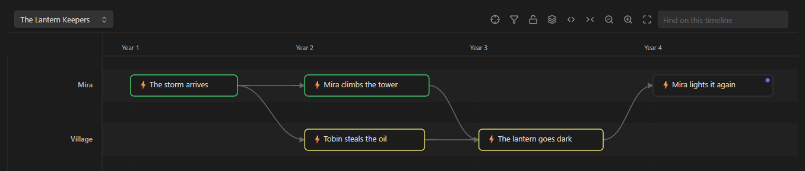

<sub>🕒 The timeline canvas — flows as lanes, time across the axis, branches drawn as curves</sub>

<br/><br/>

> **Status — 0.9.4, feature complete.** Every feature below works and is covered by
> unit tests where it can be. The frontmatter schema may still shift before 1.0.

</div>

---

## 💡 Why

Worldbuilding notes rarely get written in order. You write part 1, leave it half
finished, jump to part 4, then go back to part 0. Later you decide the war
started twenty years earlier than you first wrote, and eight notes have to change
together — but you want to keep the old draft, because you are not sure yet.

Most tooling assumes you write forwards and never change your mind. This plugin
assumes the opposite:

| | |
|---|---|
| 🌱 | **Unfinished is a normal state**, not an error to clear |
| 🌿 | **A fragment can lead to different places in different drafts**, and switching drafts reshapes the timeline |
| 📦 | **Nothing is deleted.** Old versions and unused ideas stay where you can find them |

Everything lives in ordinary Markdown with ordinary frontmatter. Uninstall the
plugin and your universe is still a readable set of notes.

---

## 🧩 Concepts

Four ideas, kept deliberately separate:

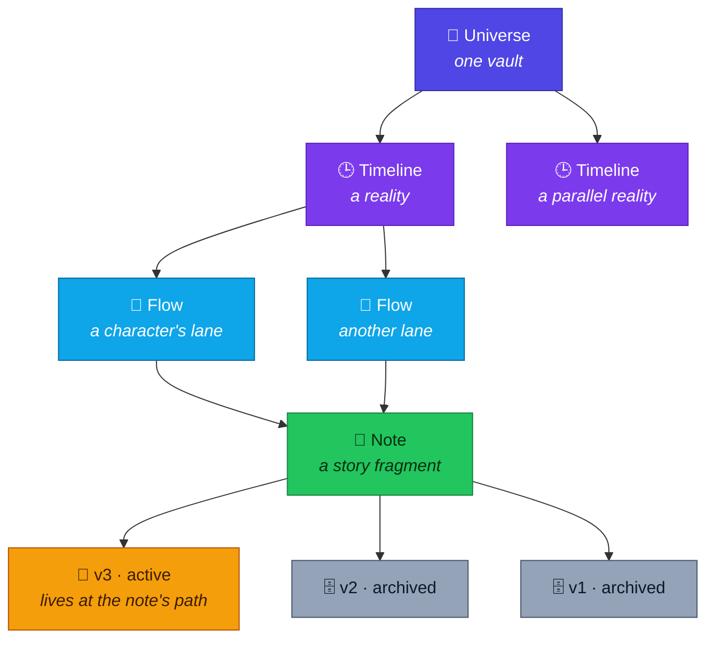

| | Concept | What it is | Part of the fiction? |
|---|---|---|---|
| 🕒 | **Timeline** | A reality — the main universe, or a parallel one | ✅ Yes |
| 🧵 | **Flow** | A lane inside a timeline, usually one character's thread. Lanes cross, merge, and split again | ✅ Yes |
| 📝 | **Version** | A draft of one note. Carries its own time, flow and connections | ❌ An authoring tool |
| 🚦 | **Status** | `draft` · `partial` · `done` | ❌ An authoring tool |

> [!IMPORTANT]
> **A parallel universe is a timeline; a second attempt at the same scene is a
> version.** Confusing the two is the fastest way to make a vault incoherent.

---

## ✨ Features

| | | |
|---|---|---|
| 🌿 | **Branching canvas** | Time across the x axis, flows as lanes, `next`/`prev` drawn as curves |
| 📝 | **Versions that reshape the story** | Each draft carries its own time, flow and connections |
| 📚 | **Version sets** | Flip a whole story revision back and forth in one move |
| 📅 | **Your own time system** | Any unit, any epoch, optional mapping to Earth years |
| 🗂️ | **Types and entities** | Characters, species, places, factions, objects, events — defined in a note, not in code |
| ⚖️ | **Laws** | Universe physics and the entities that break them, linked both ways |
| 💡 | **Drafts you can promote** | A shelf for homeless ideas, turned into real notes when they earn it |
| 🧭 | **Navigation** | A banner on top of each note and a bar underneath showing every place it leads, with a map |
| 📊 | **Dashboard & consistency** | Counts, everything unfinished, and an advisory report with 15 kinds of checks |
| 🔍 | **Search & export** | Filter by field, then build one Markdown document from what you choose |
| ⌨️ | **Keyboard and touch** | Walk the timeline with arrow keys, pinch to zoom, Enter submits every dialog |
| 📖 | **Built-in guide** | A friendly tour inside Obsidian, with an FAQ and an example story to explore |

### 🌿 Branching timeline canvas

Notes carrying a timeline id are laid out with time across the x axis and flows
as lanes. Connections come from `next` and `prev`, drawn as curves so converging
threads stay readable.

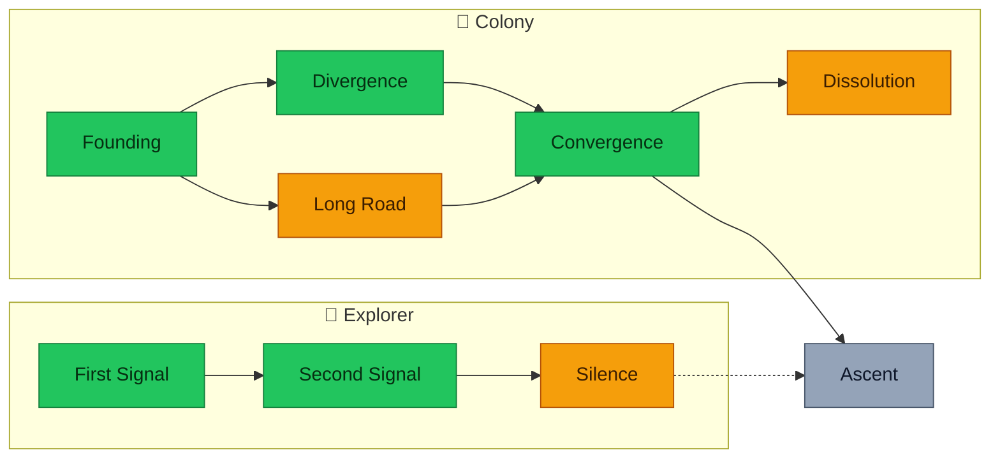

<div align="center"><sub>🟩 done &nbsp;·&nbsp; 🟨 partial &nbsp;·&nbsp; ⬜ draft &nbsp;·&nbsp; dashed = uncertain</sub></div>

- Boxes widen to show duration (`time-end`) and go dashed when approximate
  (`time-uncertain`).
- Notes with **no time yet** get their own lane instead of vanishing.
- Border colour reflects status; a dot marks fragments that have other versions.
- Pan, zoom, click through to any note. Lane names and dates stay pinned at
  the edges while you pan.
- **Filter** by status, flow or type, or **search** the canvas: what does not
  match dims, nothing moves. Enter steps through the hits.
- **Show the open note** jumps to the note you are writing, on whichever
  timeline it sits.
- **Keyboard:** Tab reaches the notes, arrows walk between them, Enter opens,
  `+` `−` zoom, `0` fits, `/` searches. On touch, pinch to zoom.
- A parallel timeline shows where it split from its parent, with a marker at
  that moment.
- Lucide icons work on the canvas as well as emoji.

<div align="center">

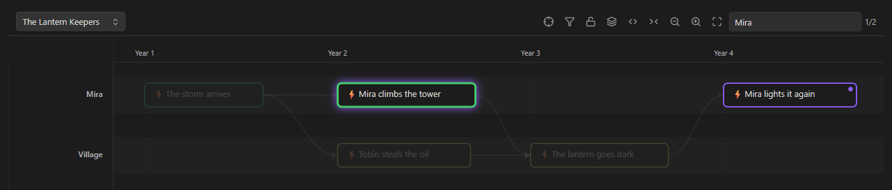

<sub>🔍 Searching for “Mira” — hits are outlined, the current one glows, the rest dims; nothing moves</sub>

</div>

### 📝 Versions that reshape the story

Each version of a note carries its prose *and* its time, flow and connections. In
one draft a scene leads to a battle; in another it leads somewhere else. Switch
versions and the timeline redraws.

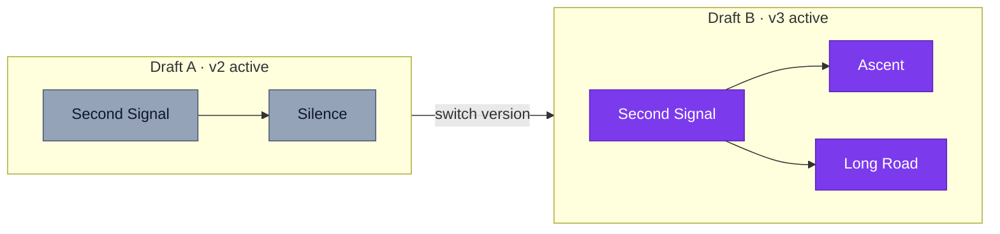

The active version always stays at the note's own path, so `[[links]]` elsewhere
in the vault never break. Older versions wait in an archive folder and are found
by following `version-of` rather than by a list that could drift out of date.

**📚 Version sets** name a snapshot of which version of each note is active. One
story revision usually touches many notes; without this, going back to the
earlier draft means remembering and flipping every one of them by hand.

> [!NOTE]
> Every file move is preceded by a dialog naming the exact paths, ordered so the
> current content reaches its new home before anything overwrites it. Records the
> plugin writes (`version-of`, version sets, promotions) use link text that names
> only one note, so two notes sharing a name in different folders never get mixed up.

### 📅 Your own time system

A universe does not have to run on Earth years.

```yaml
time: 134923.4521          # always a single sortable number
time-precision: date       # year · date · datetime
time-label: "Xen Year 134923, day 165"
earth-time: 2050           # optional reference for readers
```

Define the time system once — unit name, days per unit, and, if you want, how
it maps to Earth years — and the time picker fills in the number and the label
for you. Or leave the mapping out and write the label yourself.

**Edit time system** (a command, also in settings) changes it later, with a
live example and a warning before anything invalid is saved. If you change the
number of days in a unit while notes already carry a date, it asks first: move
those notes so each keeps the same day, or leave the numbers as they are. The
move touches every dated note or none of them.

<div align="center">

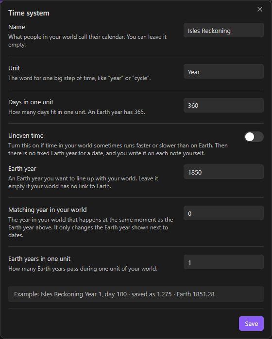

<sub>📅 The time system editor — the example line shows how a date is stored and read</sub>

</div>

### 🗂️ Types and entities

Characters, species, places, factions, objects, events, laws, drafts. Each type
brings its own fields, its own template and its own default icon.

The registry lives in a note's frontmatter, so **adding a type is editing a note,
not editing this plugin** — and any AI assistant reading your vault can see what
your types mean.

### ⚖️ Laws that know who breaks them

Universe-wide physics and entity-specific rules, kept as two layers. Entities
declare which laws they are subject to and which they break; the laws view
inverts those links so a law shows both. Laws can be scoped to particular
timelines, for when a parallel reality runs on different physics.

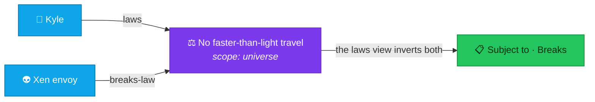

<div align="center">

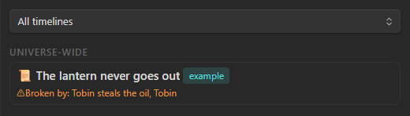

<sub>⚖️ Each law shows who is bound by it and who breaks it</sub>

</div>

### 💡 Drafts you can promote

A shelf for ideas that have no home yet. Open one beside whatever you are
writing without losing your place. When an idea earns a place in the story,
promote it: pick the type and the folder, and choose whether the draft keeps its
text or hands it over. Either way the draft survives and the two notes reference
each other.

### 🧭 Banner and navigation

Every lore note gets a **banner** on top — its icon, type, status (click to
cycle), version and its place in time (click to change it) — and a **bar**
underneath showing where it leads. Fragments often lead to more than one place,
so every destination gets its own button. Hover to preview the destination on a
map that can show the whole timeline or just what is one step away — and can be
pinned open.

<div align="center">

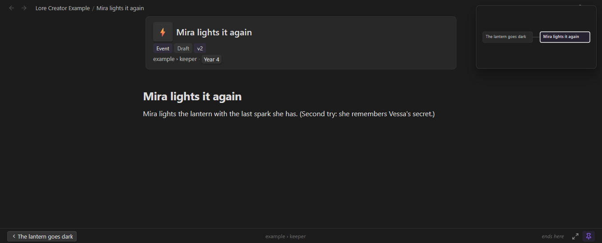

<sub>🧭 Banner on top, map in the corner, the way back and forward at the bottom</sub>

</div>

An empty `next` means the thread ends there. Nothing is invented to fill it.
An archived version shows a slim bar instead, with a button back to the active one.

### 📊 Dashboard, search and export

| | | |
|---|---|---|
| 📊 | **Dashboard** | Counts by type, everything unfinished (half-written sorted above untouched), and a consistency report |
| 🩺 | **Consistency** | Fifteen kinds of checks (listed below), each with a chip to switch it off. **Advisory only:** it corrects nothing and blocks nothing, because most findings are work in progress rather than mistakes |
| 🔍 | **Search** | Filters by type, status, timeline, flow and time range. Obsidian's own search already covers the words; this answers *"every unfinished character in the main universe"* |
| 📤 | **Export** | One Markdown document from the sections you choose. This is why notes carry no privacy flag: what a reader sees is decided when you share, not stored on every note forever |

<table><tr><td width="50%" valign="top">

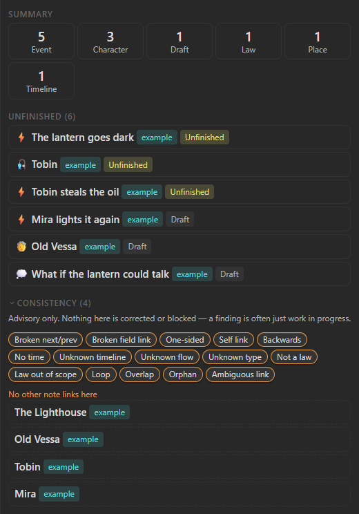

</td><td valign="top">

**What the consistency report checks**

- **Links:** broken `next`/`prev`, broken links in any other field,
  one-sided `next`/`prev`, a note that leads to itself
- **Story:** links that go backwards in time, `next` loops, two periods
  overlapping in one flow, notes on a timeline with no time
- **Structure:** unknown timeline, flow or type, notes nothing links to,
  old records that name a note several notes share
- **Laws:** a law target that is not a law, a law broken outside the
  timelines it holds in

Each kind has a chip; switched-off kinds leave the count too. While Obsidian is
still reading the vault's links, the orphan check waits and says so.

</td></tr></table>

### 📖 Built-in guide

A tour written so that anyone can follow it, opened once by itself the first
time the plugin starts. One chapter per screen, in four groups — *Getting
started*, *While writing*, *Keeping track*, *Help* — with small diagrams, a
progress bar and read marks. Chapters carry buttons that do the step they
describe: set up the universe, set up time, make a note, open the timeline.

The last chapter is a searchable FAQ. Field names appear only in the
*For the curious* boxes, so the main text stays plain.

**Example story.** *The Lantern Keepers* is a 13-page universe with two flows,
three characters, a broken law, a draft idea and a note with two versions.
It is written to its own folder in the language you choose, every page is
marked with an *example* badge in the views, and one button removes it again
(to the trash, never deleted outright). Pages you copied from it stay yours.

Open the guide from the book icon in the ribbon, the **Open guide** command, or
**Settings → Help**.

<div align="center">

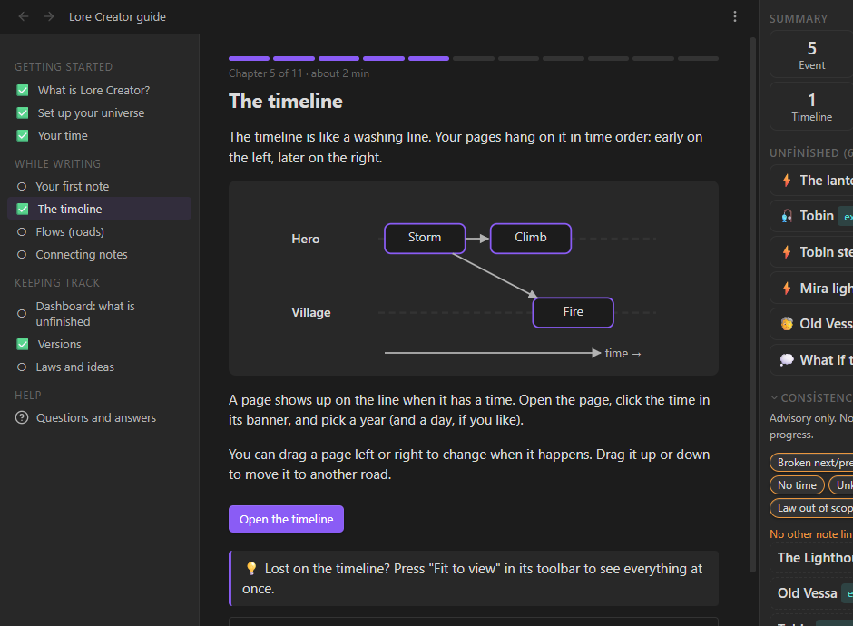

<sub>📖 One chapter per screen, with a diagram and a button that does the step</sub>

</div>

---

## 🚀 Getting started

### 📥 Install

Not yet in the community plugin browser. Until then:

1. Download `main.js`, `manifest.json` and `styles.css` from the
   [latest release](https://github.com/PancstaR/lore-creator/releases/latest).
2. Put them in `<vault>/.obsidian/plugins/lore-creator/`.
3. In Obsidian: **Settings → Community plugins**, turn off Restricted Mode, then
   enable *Lore Creator*.

> [!TIP]
> On first start the guide opens by itself. Its *Set up your universe* chapter
> walks through the next two steps, and you can make the example story to see
> every view filled in before writing your own.

### 🪄 Set up a vault

Run **Set up this vault** from the command palette. It creates the folders,
templates and type registry the views read from — previewing the exact tree
first, and never overwriting a file that already exists. One step asks for
your time system: a unit name, days per unit, and an optional link to Earth
years. Files are written first and settings last, so a setup that stops halfway
changes nothing; running it again only fills in what is missing.

```
📁 <vault>
├── 📄 Universe.md            ← time system, timelines, universe-wide laws
├── 📁 System/
│   ├── 📄 Types.md           ← the type registry: edit a note, not the plugin
│   └── 📄 Version sets.md
├── 📁 Templates/
├── 📁 Versions/              ← archived versions, found via version-of
└── 📁 Exports/
```

Folder names are chosen separately from the interface language: a universe is
written in whatever language its story is, which is not necessarily the language
of your menus.

### ✍️ Write something

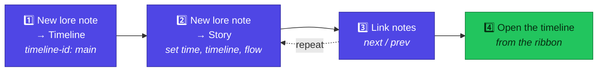

1. **New lore note** → pick *Timeline*, name it, give it a `timeline-id` such as
   `main`, and list its flows.
2. **New lore note** → pick *Story*. In the banner at the top, click the time to
   place it, and set `timeline` and `flow` in the properties.
3. Repeat, linking notes with `next`.
4. Open the timeline from the ribbon.

---

## 🏷️ How notes are described

<details open>
<summary><b>Standard fields</b> — on every lore note</summary>

| Field | Meaning |
|---|---|
| `type` | Which type this is — the folder is only organisation |
| `icon` / `icon-type` | An emoji or a Lucide icon name |
| `status` | `draft` · `partial` · `done` |
| `aliases` | Obsidian's own field; resolves `[[Lord Kyle]]` to this note |
| `alias-history` | When and why a name changed |
| `related` | Free-form links |

</details>

<details>
<summary><b>🕒 Timeline placement</b> — when a note has one</summary>

| Field | Meaning |
|---|---|
| `timeline` | Which reality it belongs to |
| `flow` | Which lane |
| `time` | A single number. Sorting depends only on this. May be empty |
| `time-precision` | `year` · `date` · `datetime` |
| `time-label` | What readers see |
| `time-end` | Set when this spans a period rather than a moment |
| `time-uncertain` | Drawn dashed |
| `earth-time` | Optional reference, computed or written by hand |
| `next` / `prev` | Connections. More than one means the story branches |

</details>

<details>
<summary><b>📝 Versioning</b></summary>

| Field | Meaning |
|---|---|
| `version` | `v1`, `v2`, … |
| `version-name` | Optional label, also used in the archive filename |
| `version-note` | What is different about this draft |
| `version-of` | Present only on archived versions |

</details>

<details>
<summary><b>⚖️ Laws and 💡 drafts</b></summary>

| Field | Meaning |
|---|---|
| `scope` | `universe` or `local` |
| `applies-to` / `timeline-scope` | Where a law holds. Empty means everywhere |
| `laws` / `breaks-law` | Declared on entities; the laws view inverts them |
| `idea-for` | What a draft is an idea for |
| `promoted-to` / `promoted-from` | The two-way link left by a promotion |

</details>

---

## ⌨️ Commands

| | Command | What it does |
|---|---|---|
| 🪄 | Set up this vault | Create folders, templates and the type registry |
| 📄 | New lore note | Create a note from a type's template |
| 🪟 | Open timeline / laws / drafts / dashboard | Open a view |
| 📖 | Open guide | Open the built-in guide |
| 📅 | Edit time system | Change the unit, days per unit and the link to Earth time |
| 📝 | Versions of this note | List, create, switch and archive versions |
| 📚 | Version sets | Capture and apply named snapshots |
| 🧭 | Go to the next / previous fragment | Follow a connection; asks when there are several |
| 🎯 | Show this note on the timeline | Open the timeline centred on the current note |
| 💡 | Promote this draft | Turn a sketch into a real note |
| 🔍 | Find in the universe | Search by field rather than by text |
| 📤 | Export the universe | Build a single Markdown document |

**On the timeline:** <kbd>Tab</kbd> reaches the notes, arrow keys walk between
them, <kbd>Enter</kbd> opens one, <kbd>+</kbd> <kbd>−</kbd> zoom, <kbd>0</kbd>
fits, <kbd>/</kbd> jumps to search. **In dialogs:** <kbd>Enter</kbd> in a text
field presses the main button.

---

## ⚙️ Settings

Every path is configurable; these are the defaults:

| Setting | Default |
|---|---|
| Universe file | `Universe.md` |
| Type registry | `System/Types.md` |
| Versions folder | `Versions` |
| Templates folder | `Templates` |
| Version sets file | `System/Version sets.md` |
| Exports folder | `Exports` |

The time system is written into the universe note's frontmatter rather than
plugin data, so a vault stays self-describing even without the plugin installed.
The type registry lives in a note for the same reason. Settings also has an
**Edit time system** button and a **Help** group that opens the guide.

Notes inside the templates folder are never counted as lore: they stay out of
the timeline, dashboard, search, export and consistency report.

Interface language follows Obsidian's own, or can be set explicitly. **🇬🇧 English
and 🇹🇷 Turkish** are included. Frontmatter field names are English in every
language — they are data, not interface.

---

## 🛠️ Development

```bash
npm install
npm run dev     # esbuild watch — rebuilds dist/ on save
npm run lint    # eslint with eslint-plugin-obsidianmd
npm test        # vitest unit tests (time, links, audit, settings…)
npm run build   # type-check, lint, then a minified dist/main.js
```

Every build writes `main.js`, `manifest.json` and `styles.css` into `dist/` —
exactly the three files a vault's plugin folder needs.

The sources live outside any vault. To work on the plugin, point a vault's
plugin folder at `dist/` — a junction or symlink keeps it to one copy:

```bash
# Windows (cmd), no administrator rights needed
mklink /J "<vault>\.obsidian\plugins\lore-creator" "<path to this repo>\dist"

# Windows (PowerShell)
New-Item -ItemType Junction -Path "<vault>\.obsidian\plugins\lore-creator" -Target "<path to this repo>\dist"

# macOS and Linux
ln -s "<path to this repo>/dist" "<vault>/.obsidian/plugins/lore-creator"
```

Obsidian does not reload plugins by itself.
[Hot Reload](https://github.com/pjeby/hot-reload) picks up rebuilds
automatically; without it, run *Reload app without saving* after each change.

Every push and pull request runs `npm ci`, `npm run build` and `npm test` in CI.

Releases are tagged with the version number exactly, with no `v` prefix. Pushing
the tag builds the plugin and publishes `main.js`, `manifest.json` and
`styles.css` from `dist/` as individual assets, which is what Obsidian expects.

There are no runtime dependencies — nothing third-party is bundled into
`main.js`.

---

## 🤝 Contributing

Issues and pull requests are welcome. Two things worth knowing before you start:

- 🗄️ **The vault is the source of truth.** Anything the plugin knows should be
  readable from the notes themselves, so a universe survives without it.
- 🛡️ **Nothing destructive happens without a dialog** naming the exact files, and
  file moves are ordered so a failure leaves a duplicate rather than a hole.

---

<div align="center">

**Lore Creator** &nbsp;·&nbsp; by **[PancstaR](https://github.com/PancstaR)** &nbsp;·&nbsp; [MIT](LICENSE)

<sub>Made for writers who change their minds ✍️</sub>

</div>
