<div align="center">

# 🌌 Lore Creator

### Obsidian içinde kurgu evrenleri kur
#### Dallanan zaman çizgileri · sürümlenen taslaklar · kendi zaman sistemin

[English](README.md) &nbsp;·&nbsp; **Türkçe**

<br/>

[](https://obsidian.md)
[](https://github.com/PancstaR/lore-creator/releases/latest)
[](https://obsidian.md)
[](#️-ayarlar)
[](LICENSE)

<br/>

[**✨ Özellikler**](#-özellikler) &nbsp;·&nbsp;
[**🧩 Kavramlar**](#-kavramlar) &nbsp;·&nbsp;
[**🚀 Başlangıç**](#-başlangıç) &nbsp;·&nbsp;
[**🏷️ Frontmatter**](#️-notlar-nasıl-tanımlanır) &nbsp;·&nbsp;
[**⌨️ Komutlar**](#️-komutlar) &nbsp;·&nbsp;
[**🛠️ Geliştirme**](#️-geliştirme)

<br/>

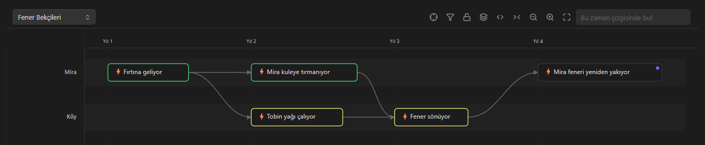

<sub>🕒 Zaman çizgisi tuvali — akışlar şerit, zaman yatay eksen, dallanmalar eğri çizgi</sub>

<br/><br/>

> **Durum — 0.11.0, özellikler tamam.** Aşağıdaki her özellik çalışıyor ve
> mümkün olan yerlerde birim testleriyle korunuyor. Frontmatter şeması 1.0'a kadar
> değişebilir.

</div>

---

## 💡 Neden

Evren notları nadiren sırayla yazılır. 1. bölümü yazarsın, yarım bırakırsın,
4'e atlarsın, sonra 0'a dönersin. Daha sonra savaşın yirmi yıl önce başlaması
gerektiğine karar verirsin ve sekiz notun birlikte değişmesi gerekir — ama eski
taslağı da saklamak istersin, çünkü henüz emin değilsindir.

Çoğu araç ileriye doğru yazdığını ve fikrini hiç değiştirmediğini varsayar. Bu
eklenti tersini varsayar:

| | |
|---|---|
| 🌱 | **Yarım kalmış olmak normal bir durumdur**, temizlenecek bir hata değil |
| 🌿 | **Bir parça farklı taslaklarda farklı yerlere bağlanabilir** ve taslak değiştirmek zaman çizgisini yeniden şekillendirir |
| 📦 | **Hiçbir şey silinmez.** Eski sürümler ve kullanılmamış fikirler bulabileceğin yerde kalır |

Her şey sıradan Markdown ve sıradan frontmatter içinde durur. Eklentiyi
kaldırırsan evrenin hâlâ okunabilir bir not kümesidir.

---

## 🧩 Kavramlar

Dört fikir, bilinçli olarak ayrı tutulmuş:

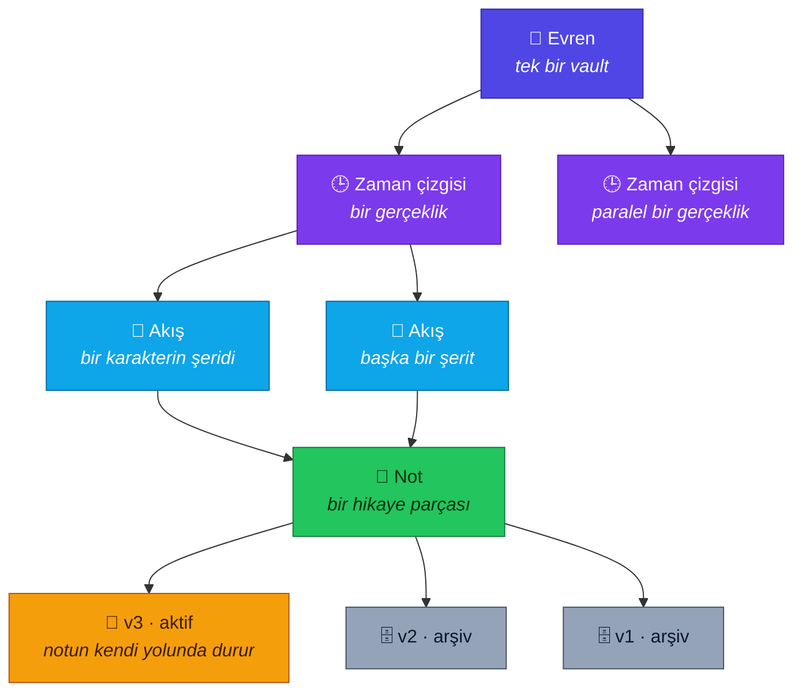

| | Kavram | Nedir | Kurgunun parçası mı? |
|---|---|---|---|
| 🕒 | **Zaman çizgisi** | Bir gerçeklik — ana evren ya da paralel bir evren | ✅ Evet |
| 🧵 | **Akış** | Zaman çizgisi içinde bir şerit, genelde bir karakterin hattı. Şeritler kesişir, birleşir, tekrar ayrılır | ✅ Evet |
| 📝 | **Sürüm** | Bir notun taslağı. Kendi zamanını, akışını ve bağlantılarını taşır | ❌ Yazarın aracı |
| 🚦 | **Durum** | `draft` · `partial` · `done` | ❌ Yazarın aracı |

> [!IMPORTANT]
> **Paralel evren bir zaman çizgisidir; aynı sahnenin ikinci denemesi bir
> sürümdür.** Bu ikisini karıştırmak, bir vault'u tutarsız hale getirmenin en
> hızlı yoludur.

---

## ✨ Özellikler

| | | |
|---|---|---|
| 🌿 | **Dallanan tuval** | Yatayda zaman, dikeyde akış şeritleri, `next`/`prev` eğri çizgilerle |
| 📝 | **Hikayeyi yeniden şekillendiren sürümler** | Her taslak kendi zamanını, akışını ve bağlantılarını taşır |
| 📚 | **Sürüm setleri** | Bütün bir kurgu revizyonunu tek hamlede ileri geri çevir |
| 📅 | **Kendi zaman sistemin** | İstediğin birim, istediğin sıfır noktası, isteğe bağlı Dünya karşılığı |
| 🗂️ | **Türler ve varlıklar** | Karakter, tür, mekân, fraksiyon, nesne, olay — kodda değil, bir notta tanımlı |
| ⚖️ | **Yasalar** | Evren fiziği ve onu çiğneyen varlıklar, iki yönlü bağlı |
| 🕸️ | **İlişkiler** | Kim nerede yaşıyor, kim hangi grupta, kim neye katılıyor — açık notun çevresinde çizilir |
| 💡 | **Terfi edilebilen taslaklar** | Yeri olmayan fikirler için raf; hak ettiğinde gerçek nota dönüşür |
| 🧭 | **Gezinme** | Her notun üstünde bir şerit, altında nereye bağlandığını gösteren çubuk ve harita |
| 📊 | **Pano ve tutarlılık** | Sayılar, yarım kalan her şey ve 15 çeşit kontrollü, uyarı amaçlı rapor |
| 🔍 | **Arama ve dışa aktarma** | Alanlara göre süz, seçtiklerini Markdown notu, HTML kitap, HTML wiki ya da PDF olarak paylaş |
| ⌨️ | **Klavye ve dokunmatik** | Zaman çizgisinde oklarla gez, iki parmakla yakınlaştır, her pencerede Enter gönderir |
| 📖 | **Eklenti içi rehber** | Obsidian içinde sade bir gezinti; SSS ve kurcalanacak örnek bir hikâyeyle |

### 🌿 Dallanan zaman çizgisi tuvali

Zaman çizgisi kimliği taşıyan notlar, yatayda zamana, dikeyde akış şeritlerine
göre yerleştirilir. Bağlantılar `next` ve `prev` alanlarından gelir; kesişen
hatlar okunaklı kalsın diye eğri çizilir.

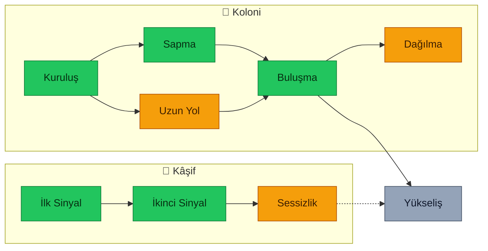

<div align="center"><sub>🟩 done &nbsp;·&nbsp; 🟨 partial &nbsp;·&nbsp; ⬜ draft &nbsp;·&nbsp; kesikli = belirsiz zaman</sub></div>

- Kutular süreyi göstermek için genişler (`time-end`), yaklaşıksa kesikli
  çizilir (`time-uncertain`).
- **Henüz zamanı olmayan** notlar kaybolmaz, kendi şeritlerine yerleşir.
- Kenar rengi durumu gösterir; başka sürümü olan parçalarda bir nokta belirir.
- Kaydır, yakınlaştır, herhangi bir nota tıklayıp geç. Kaydırırken şerit
  adları ve tarihler kenarlarda sabit kalır.
- Duruma, akışa ya da türe göre **süz** veya tuvalde **ara**: eşleşmeyenler
  soluklaşır, hiçbir şey yer değiştirmez. Enter sonuçlar arasında gezer.
- **Açık notu göster**, yazdığın notu hangi zaman çizgisindeyse orada bulur.
- **Klavye:** Tab notlara ulaşır, oklar aralarında gezer, Enter açar, `+` `−`
  yakınlaştırır, `0` sığdırır, `/` arar. Dokunmatikte iki parmakla yakınlaştır.
- Paralel bir zaman çizgisi ana çizgiden nerede ayrıldığını ve o anı bir
  işaretle gösterir.
- Tuvalde emojinin yanında Lucide ikonları da kullanılabilir.

<div align="center">

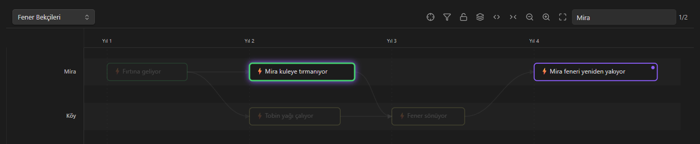

<sub>🔍 “Mira” araması — sonuçlar çerçevelenir, geçerli olan parlar, gerisi soluklaşır; hiçbir şey yer değiştirmez</sub>

</div>

### 📝 Hikayeyi yeniden şekillendiren sürümler

Bir notun her sürümü metnini **ve** zamanını, akışını, bağlantılarını birlikte
taşır. Bir taslakta sahne bir savaşa bağlanır, başka bir taslakta bambaşka bir
yere. Sürümü değiştir, zaman çizgisi yeniden çizilir.

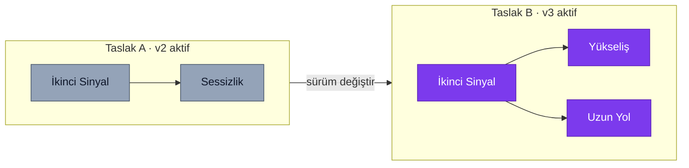

Aktif sürüm her zaman notun kendi yolunda durur; böylece vault'un başka
yerlerindeki `[[bağlantılar]]` hiç kırılmaz. Eski sürümler bir arşiv klasöründe
bekler ve gerçekle uyuşmayı bırakabilecek bir liste yerine `version-of` bağı
takip edilerek bulunur.

**📚 Sürüm setleri**, hangi notun hangi sürümünün aktif olduğunun isimli anlık
görüntüsünü tutar. Bir kurgu revizyonu genelde birçok notu birden etkiler;
bunlar olmasa eski taslağa dönmek, hepsini tek tek hatırlayıp çevirmek demektir.

> [!NOTE]
> Dosya taşıyan her işlemin önünde, ilgili yolları tek tek yazan bir onay
> penceresi vardır; sıralama, mevcut içerik yeni yerine ulaşmadan hiçbir şeyin
> üzerine yazılmayacak şekilde kurulmuştur. Eklentinin yazdığı kayıtlar
> (`version-of`, sürüm setleri, terfiler) yalnız tek bir notu gösteren bağlantı
> metniyle yazılır; farklı klasörlerdeki aynı adlı notlar asla karışmaz.

### 📅 Kendi zaman sistemin

Bir evren Dünya yıllarıyla işlemek zorunda değildir.

```yaml
time: 134923.4521          # her zaman tek bir sıralanabilir sayı
time-precision: date       # year · date · datetime
time-label: "Xen Yılı 134923, 165. gün"
earth-time: 2050           # okuyucu için isteğe bağlı referans
```

Zaman sistemini bir kere tanımla — birim adı, birim başına gün ve istersen
Dünya yıllarına nasıl karşılık geldiği — zaman seçici sayıyı ve etiketi senin
yerine doldursun. Ya da karşılığı hiç tanımlama, etiketi kendin yaz.

**Zaman sistemini düzenle** (bir komut, ayarlarda da var) sistemi sonradan
değiştirir; canlı bir örnek gösterir ve geçersiz bir değer kaydedilmeden önce
uyarır. Tarihi olan notlar varken bir birimdeki gün sayısını değiştirirsen önce
sorar: bu notları her biri aynı günde kalacak şekilde taşı ya da sayıları
olduğu gibi bırak. Taşıma ya tarihli notların hepsine uygulanır ya da hiçbirine.

<div align="center">

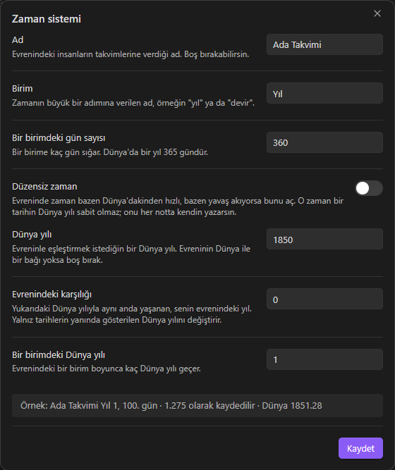

<sub>📅 Zaman sistemi düzenleyicisi — örnek satırı bir tarihin nasıl saklanıp okunacağını gösterir</sub>

</div>

### 🗂️ Türler ve varlıklar

Karakter, tür, mekân, fraksiyon, nesne, olay, yasa, taslak. Her türün kendi
alanları, kendi şablonu ve kendi varsayılan simgesi var.

Tür kaydı bir notun frontmatter'ında durur; yani **yeni tür eklemek bir notu
düzenlemektir, bu eklentiyi düzenlemek değil** — ve vault'unu okuyan herhangi
bir yapay zekâ, türlerinin ne anlama geldiğini görebilir.

### 🕸️ İlişkiler

Zaman çizgisi neyin ne zaman olduğunu gösterir; **ilişkiler** görünümü kimin
kimle bir arada olduğunu. Açık not ortada durur; bağlantı alanlarının (üyeler,
yer, sakinler, düşmanlar…) ve yasaların onu bağladığı her not çevresinde, iki
yönde ve her çizgi kendi alanının adıyla. Bir nota tıklayınca ona geçersin,
**2**'ye basınca bir adım daha öteye bakarsın; başka notları okurken bir notu
ortada tutmak için görünümü kilitlersin.

<div align="center">

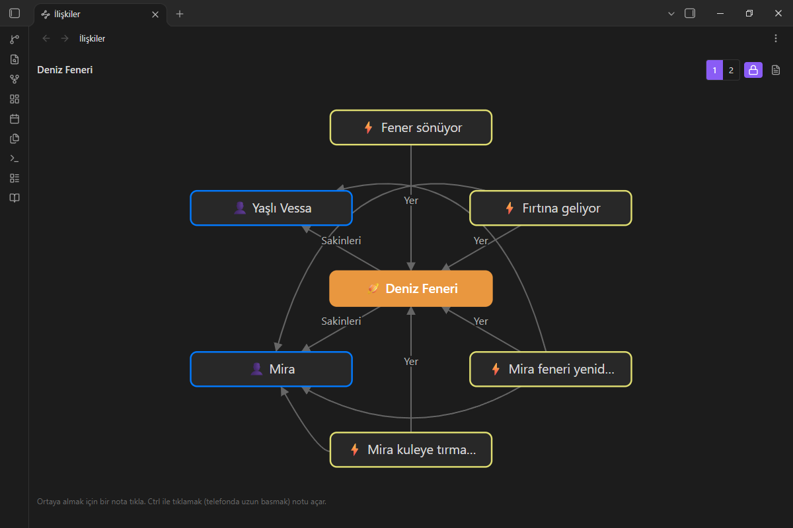

<sub>🕸️ Ortada Deniz Feneri — orada neler oluyor ve orada kim yaşıyor</sub>

</div>

Tür kaydında bir türe eklediğin her `link` ya da `links` alanı burada görünür.

### ⚖️ Kimin çiğnediğini bilen yasalar

Evren geneli fizik ve varlığa özel kurallar, iki katman halinde. Varlıklar hangi
yasalara tabi olduklarını ve hangilerini çiğnediklerini bildirir; yasalar
görünümü bu bağları ters çevirerek yasanın altında ikisini birden gösterir.
Yasalar belirli zaman çizgileriyle sınırlandırılabilir — paralel bir gerçeklik
farklı fizikle işliyorsa.

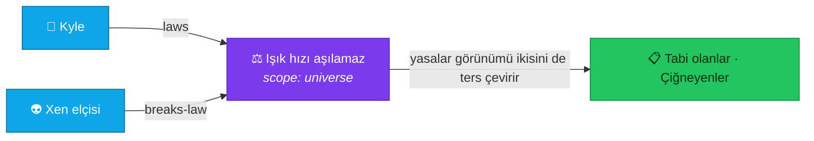

<div align="center">

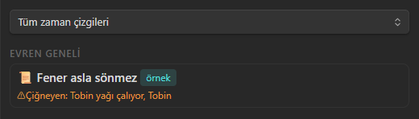

<sub>⚖️ Her yasa kimin tabi olduğunu ve kimin çiğnediğini gösterir</sub>

</div>

### 💡 Terfi edilebilen taslaklar

Henüz yeri olmayan fikirler için bir raf. Yazdığın notun yanında açıp yerini
kaybetmeden bakabilirsin. Bir fikir hikayede yerini hak ettiğinde terfi ettir:
türünü ve klasörünü seç, taslağın metnini kendinde mi tutacağını yoksa
devredeceğini mi belirle. Her iki durumda da taslak yaşamaya devam eder ve iki
not birbirini gösterir.

### 🧭 Şerit ve gezinme

Her lore notunun üstünde bir **şerit** durur — simgesi, türü, durumu (tıklayınca
değişir), sürümü ve zamandaki yeri (tıklayınca değiştirilir) — altında da nereye
bağlandığını gösteren bir **çubuk**. Parçalar çoğu zaman birden fazla yere
bağlanır, o yüzden her hedefin kendi düğmesi olur. Üzerine gelince hedef, tüm
zaman çizgisini ya da sadece bir adım ötesini gösterebilen bir haritada belirir —
harita sabitlenebilir.

<div align="center">

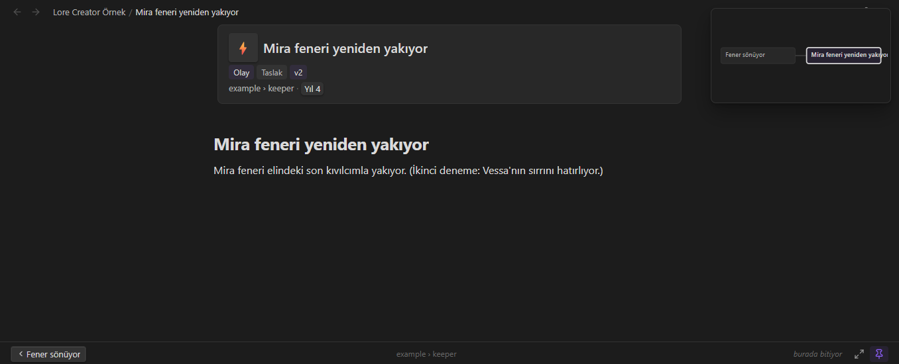

<sub>🧭 Üstte şerit, köşede harita, altta geri ve ileri yol</sub>

</div>

Boş bir `next` alanı, hattın orada bittiği anlamına gelir. Yerini doldurmak için
hiçbir şey uydurulmaz. Arşivlenmiş bir sürüm açıldığında bunun yerine ince bir
çubuk ve aktif sürüme dönen bir düğme çıkar.

### 📊 Pano, arama ve dışa aktarma

| | | |
|---|---|---|
| 📊 | **Pano** | Türe göre sayılar, yarım kalan her şey (yarısı yazılmışlar dokunulmamışların üstünde) ve tutarlılık raporu |
| 🩺 | **Tutarlılık** | On beş çeşit kontrol (aşağıda), her biri bir çiple kapatılabilir. **Sadece uyarı amaçlı:** hiçbir şeyi düzeltmez, hiçbir işlemi engellemez; çünkü bulguların çoğu hata değil, devam eden iştir |
| 🔍 | **Arama** | Türe, duruma, zaman çizgisine, akışa ve zaman aralığına göre süzer. Obsidian'ın kendi araması kelimeleri zaten buluyor; bu, *"ana evrende yarım kalmış tüm karakterler"* sorusunu cevaplıyor |
| 📤 | **Dışa aktarma** | Seçtiğin notlar, türe ya da zaman çizgisine göre bölümlenmiş olarak: Markdown notu, tek sayfa **HTML kitap** (görseller içinde, çevrimdışı açılır, iyi yazdırılır), **HTML wiki** (her not bir sayfa, "buraya bağlananlar" listeleriyle) ya da Obsidian'ın kendi PDF dışa aktarımıyla **PDF**. Dışa aktarılan notlar arasındaki bağlantılar çalışır; dışarıda kalanlara bağlantılar düz metin olur. Notlarda gizlilik bayrağının olmamasının sebebi budur: okuyucunun ne göreceği paylaşırken belirlenir, her notta sonsuza kadar saklanmaz |

<table><tr><td width="50%" valign="top">

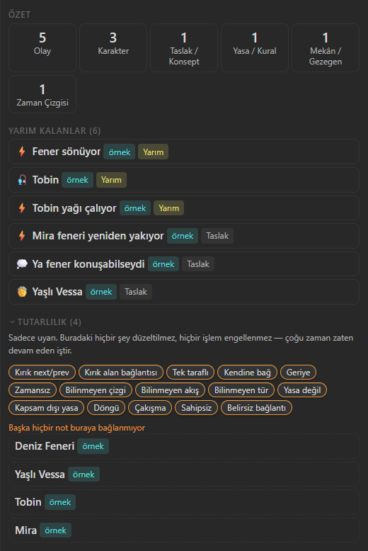

</td><td valign="top">

**Tutarlılık raporunun kontrolleri**

- **Bağlantılar:** kırık `next`/`prev`, diğer alanlardaki kırık bağlantılar,
  tek taraflı `next`/`prev`, kendine bağlanan not
- **Hikâye:** zamanca geriye giden bağlantılar, `next` döngüleri, aynı akışta
  çakışan iki dönem, zaman çizgisinde olup zamanı olmayan notlar
- **Yapı:** bilinmeyen zaman çizgisi, akış ya da tür, hiçbir notun bağlanmadığı
  notlar, birden çok notun paylaştığı adı gösteren eski kayıtlar
- **Yasalar:** yasa olmayan bir hedef, geçerli olmadığı zaman çizgisinde
  çiğnenen yasa

Her çeşidin bir çipi var; kapatılan çeşitler sayıya da girmez. Obsidian vault'taki
bağlantıları okumayı bitirene kadar sahipsiz kontrolü bekler ve bunu söyler.

</td></tr></table>

### 📖 Eklenti içi rehber

Herkesin takip edebileceği dilde yazılmış bir gezinti; eklenti ilk kez
açıldığında kendiliğinden bir kez açılır. Her ekranda bir bölüm, dört grupta —
*Başlarken*, *Yazarken*, *Takip*, *Yardım* — küçük şemalar, ilerleme çubuğu ve
okundu işaretleriyle. Bölümlerde anlattıkları adımı yapan düğmeler var: evreni
kur, zamanı ayarla, not oluştur, zaman çizgisini aç.

Son bölüm aranabilir bir SSS. Alan adları yalnız *Merak edenler için*
kutularında geçer; ana metin sade kalır.

**Örnek hikâye.** *Fener Bekçileri*, 13 sayfalık bir evren: iki akış, üç
karakter, çiğnenen bir yasa, bir taslak fikir ve iki sürümlü bir not. Seçtiğin
dilde kendi klasörüne yazılır, görünümlerde her sayfasının yanında *örnek*
rozeti durur ve tek düğmeyle yeniden kaldırılır (çöp kutusuna gider, doğrudan
silinmez). Ondan kopyaladığın sayfalar senin kalır.

Rehberi soldaki kitap simgesinden, **Rehberi aç** komutundan ya da
**Ayarlar → Yardım** bölümünden aç.

<div align="center">

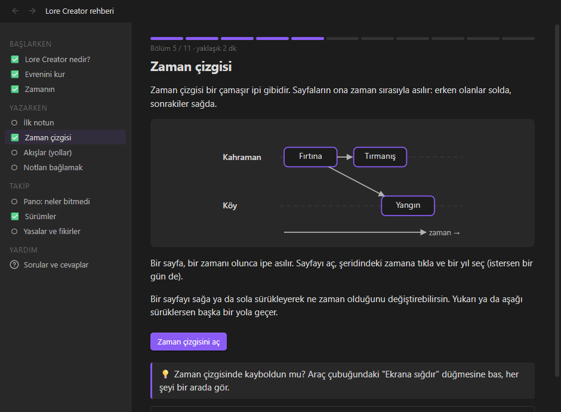

<sub>📖 Her ekranda bir bölüm; bir şema ve anlatılan adımı yapan bir düğme</sub>

</div>

---

## 🚀 Başlangıç

### 📥 Kurulum

Lore Creator, Obsidian'ın topluluk eklentileri arasında:
[community.obsidian.md/plugins/lore-creator](https://community.obsidian.md/plugins/lore-creator).

1. Obsidian'da: **Ayarlar → Topluluk eklentileri**, kısıtlı mod açıksa kapat,
   sonra **Göz at**'a bas ve *Lore Creator*'ı ara.
2. **Yükle**, ardından **Etkinleştir**.

<details>
<summary>Elle kurulum</summary>

1. [Son sürümden](https://github.com/PancstaR/lore-creator/releases/latest)
   `main.js`, `manifest.json` ve `styles.css` dosyalarını indir.
2. `<vault>/.obsidian/plugins/lore-creator/` klasörüne koy.
3. Obsidian'da: **Ayarlar → Topluluk eklentileri**, kısıtlı modu kapat, sonra
   *Lore Creator*'ı etkinleştir.

</details>

> [!TIP]
> İlk açılışta rehber kendiliğinden açılır. *Evrenini kur* bölümü sonraki iki
> adımı birlikte yürür; kendi evrenini yazmadan önce her görünümü dolu görmek
> için örnek hikâyeyi oluşturabilirsin.

### 🪄 Bir vault kur

Komut paletinden **Bu vault'u kur** komutunu çalıştır. Görünümlerin okuduğu
klasörleri, şablonları ve tür kaydını oluşturur — önce oluşturacağı ağacı
gösterir ve var olan bir dosyanın üzerine asla yazmaz. Bir adımda zaman
sistemini sorar: birim adı, birim başına gün ve isteğe bağlı Dünya yılı bağı.
Önce dosyalar, en son ayarlar yazılır; yarıda kalan bir kurulum hiçbir şeyi
değiştirmez, yeniden çalıştırınca yalnız eksikleri tamamlar.

```
📁 <vault>
├── 📄 Universe.md            ← zaman sistemi, zaman çizgileri, evren geneli yasalar
├── 📁 System/
│   ├── 📄 Types.md           ← tür kaydı: eklentiyi değil, bir notu düzenlersin
│   └── 📄 Version sets.md
├── 📁 Templates/
├── 📁 Versions/              ← arşivlenen sürümler, version-of ile bulunur
└── 📁 Exports/
```

Klasör adları arayüz dilinden ayrı seçilir: bir evren, hikayesi hangi dildeyse o
dilde yazılır ve bu, menülerinin dili olmak zorunda değildir.

### ✍️ Bir şeyler yaz

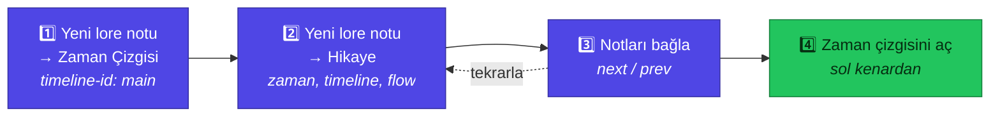

1. **Yeni lore notu** → *Zaman Çizgisi* seç, ad ver, `main` gibi bir
   `timeline-id` gir ve akışlarını listele.
2. **Yeni lore notu** → *Hikaye* seç. Üstteki afişte zamana tıklayıp yerleştir,
   özelliklerden `timeline` ve `flow` alanlarını doldur.
3. Tekrarla, notları `next` ile bağla.
4. Zaman çizgisini sol kenardan aç.

---

## 🏷️ Notlar nasıl tanımlanır

<details open>
<summary><b>Standart alanlar</b> — her lore notunda</summary>

| Alan | Anlamı |
|---|---|
| `type` | Hangi tür olduğu — klasör sadece düzen içindir |
| `icon` / `icon-type` | Bir emoji ya da Lucide ikon adı |
| `status` | `draft` · `partial` · `done` |
| `aliases` | Obsidian'ın kendi alanı; `[[Lord Kyle]]` bağlantısını bu nota çözer |
| `alias-history` | Adın ne zaman ve neden değiştiği |
| `related` | Serbest bağlantılar |

</details>

<details>
<summary><b>🕒 Zaman çizgisi yerleşimi</b> — notun bir yeri varsa</summary>

| Alan | Anlamı |
|---|---|
| `timeline` | Hangi gerçekliğe ait olduğu |
| `flow` | Hangi şerit |
| `time` | Tek bir sayı. Sıralama yalnızca buna bağlıdır. Boş olabilir |
| `time-precision` | `year` · `date` · `datetime` |
| `time-label` | Okuyucunun gördüğü metin |
| `time-end` | Bir ana değil bir döneme yayılıyorsa doldurulur |
| `time-uncertain` | Kesikli çizilir |
| `earth-time` | İsteğe bağlı referans, hesaplanır ya da elle yazılır |
| `next` / `prev` | Bağlantılar. Birden fazlaysa hikaye dallanıyordur |

</details>

<details>
<summary><b>📝 Sürümleme</b></summary>

| Alan | Anlamı |
|---|---|
| `version` | `v1`, `v2`, … |
| `version-name` | İsteğe bağlı ad, arşiv dosya adında da kullanılır |
| `version-note` | Bu taslağın farkı ne |
| `version-of` | Yalnızca arşivlenmiş sürümlerde bulunur |

</details>

<details>
<summary><b>⚖️ Yasalar ve 💡 taslaklar</b></summary>

| Alan | Anlamı |
|---|---|
| `scope` | `universe` ya da `local` |
| `applies-to` / `timeline-scope` | Bir yasanın nerede geçerli olduğu. Boşsa her yerde |
| `laws` / `breaks-law` | Varlıklarda bildirilir; yasalar görünümü bunları ters çevirir |
| `idea-for` | Taslağın ne için bir fikir olduğu |
| `promoted-to` / `promoted-from` | Terfinin bıraktığı iki yönlü bağ |

</details>

---

## ⌨️ Komutlar

| | Komut | Ne yapar |
|---|---|---|
| 🪄 | Bu vault'u kur | Klasörleri, şablonları ve tür kaydını oluşturur |
| 📄 | Yeni lore notu | Bir türün şablonundan not oluşturur |
| 🪟 | Zaman çizgisini / ilişkileri / yasaları / taslakları / panoyu aç | Bir görünüm açar |
| 📖 | Rehberi aç | Eklenti içi rehberi açar |
| 📅 | Zaman sistemini düzenle | Birimi, birim başına günü ve Dünya zamanıyla bağı değiştirir |
| 📝 | Bu notun sürümleri | Sürümleri listeler, oluşturur, değiştirir, arşivler |
| 📚 | Sürüm setleri | İsimli anlık görüntüleri yakalar ve uygular |
| 🧭 | Sonraki / önceki parçaya git | Bir bağlantıyı izler; birden fazlaysa sorar |
| 🎯 | Bu notu zaman çizgisinde göster | Zaman çizgisini açık notu ortalayarak açar |
| 💡 | Bu taslağı terfi et | Bir eskizi gerçek nota dönüştürür |
| 🔍 | Evrende ara | Metne göre değil, alanlara göre arar |
| 📤 | Evreni dışa aktar | Markdown notu, HTML kitap, HTML wiki ya da PDF üretir |

**Zaman çizgisinde:** <kbd>Tab</kbd> notlara ulaşır, ok tuşları aralarında gezer,
<kbd>Enter</kbd> açar, <kbd>+</kbd> <kbd>−</kbd> yakınlaştırır, <kbd>0</kbd>
sığdırır, <kbd>/</kbd> aramaya gider. **Pencerelerde:** bir metin alanında
<kbd>Enter</kbd> ana düğmeye basar.

---

## ⚙️ Ayarlar

Her yol değiştirilebilir; aşağıdakiler yalnızca varsayılanlardır:

| Ayar | Varsayılan |
|---|---|
| Evren dosyası | `Universe.md` |
| Tür kaydı | `System/Types.md` |
| Sürümler klasörü | `Versions` |
| Şablonlar klasörü | `Templates` |
| Sürüm setleri dosyası | `System/Version sets.md` |
| Dışa aktarım klasörü | `Exports` |

Zaman sistemi eklenti verisine değil, evren notunun frontmatter'ına yazılır;
böylece bir vault eklenti kurulu olmasa bile kendini tanımlamaya devam eder. Tür
kaydı da aynı sebeple bir notta durur. Ayarlarda ayrıca **Zaman sistemini
düzenle** düğmesi ve rehberi açan bir **Yardım** grubu var.

Şablonlar klasöründeki notlar lore sayılmaz: zaman çizgisine, panoya, aramaya,
dışa aktarmaya ve tutarlılık raporuna girmez.

Arayüz dili Obsidian'ınkini takip eder ya da elle seçilebilir. **🇬🇧 İngilizce ve
🇹🇷 Türkçe** dahildir. Frontmatter alan adları her dilde İngilizcedir — onlar
veri, arayüz değil.

---

## 🛠️ Geliştirme

```bash
npm install
npm run dev     # esbuild izler — kaydettikçe dist/ yeniden üretilir
npm run lint    # eslint-plugin-obsidianmd ile eslint
npm test        # vitest birim testleri (zaman, bağlantılar, denetim, ayarlar…)
npm run build   # tip kontrolü, lint, sonra küçültülmüş dist/main.js
```

Her derleme `main.js`, `manifest.json` ve `styles.css` dosyalarını `dist/`
klasörüne yazar — bir vault'un eklenti klasörünün ihtiyaç duyduğu üç dosya.

Kaynaklar herhangi bir vault'un dışında durur. Eklenti üzerinde çalışmak için
bir vault'un eklenti klasörünü `dist/` klasörüne yönlendir — junction ya da
symlink tek kopya kalmasını sağlar:

```bash
# Windows (cmd), yönetici izni gerekmez
mklink /J "<vault>\.obsidian\plugins\lore-creator" "<bu deponun yolu>\dist"

# Windows (PowerShell)
New-Item -ItemType Junction -Path "<vault>\.obsidian\plugins\lore-creator" -Target "<bu deponun yolu>\dist"

# macOS ve Linux
ln -s "<bu deponun yolu>/dist" "<vault>/.obsidian/plugins/lore-creator"
```

Obsidian eklentileri kendiliğinden yeniden yüklemez.
[Hot Reload](https://github.com/pjeby/hot-reload) yeni derlemeleri otomatik
alır; onsuz her değişiklikten sonra *Reload app without saving* komutunu
çalıştır.

Her push ve pull request CI'da `npm ci`, `npm run build` ve `npm test` çalıştırır.

Sürümler, başında `v` olmadan tam olarak sürüm numarasıyla etiketlenir. Etiketi
push etmek eklentiyi derler ve `dist/` içindeki `main.js`, `manifest.json`,
`styles.css` dosyalarını ayrı ayrı varlık olarak yayınlar — Obsidian'ın
beklediği budur.

Çalışma zamanı bağımlılığı yoktur; `main.js` içine hiçbir üçüncü parti kod
paketlenmez.

---

## 🤝 Katkı

Sorun bildirimleri ve pull request'ler açıktır. Başlamadan önce bilinmesi
gereken iki şey:

- 🗄️ **Doğrunun kaynağı vault'tur.** Eklentinin bildiği her şey notların
  kendisinden okunabilmelidir ki evren onsuz da ayakta kalsın.
- 🛡️ **Yıkıcı hiçbir işlem onay penceresi olmadan gerçekleşmez**; dosya
  taşımaları da bir hata durumunda boşluk değil kopya bırakacak şekilde
  sıralanmıştır.

💖 Lore Creator ücretsiz. Yazmana yardımcı oluyorsa geliştirilmesini
[GitHub Sponsors üzerinden destekleyebilirsin](https://github.com/sponsors/PancstaR).

---

<div align="center">

**Lore Creator** &nbsp;·&nbsp; **[PancstaR](https://github.com/PancstaR)** &nbsp;·&nbsp; [MIT](LICENSE)

<sub>Fikrini değiştiren yazarlar için ✍️</sub>

</div>
